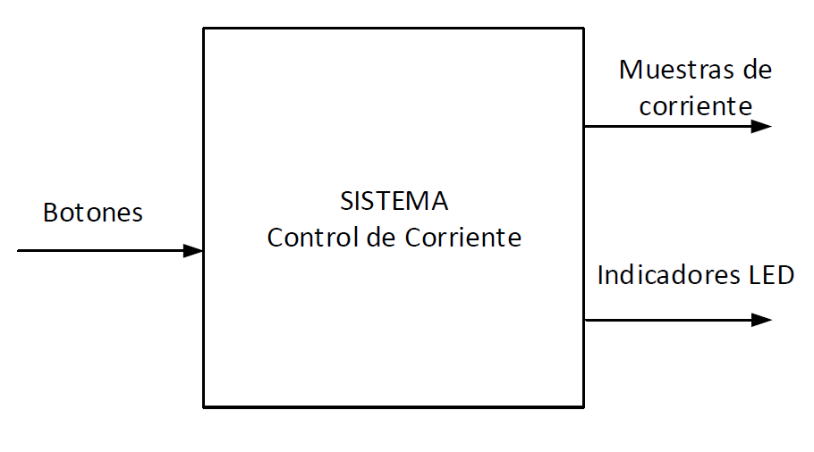
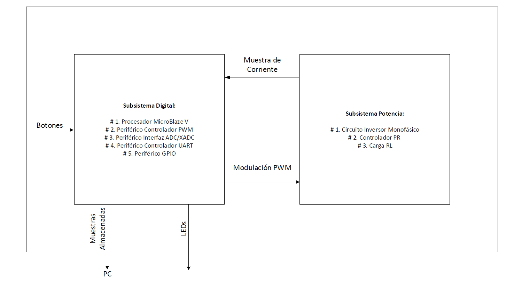
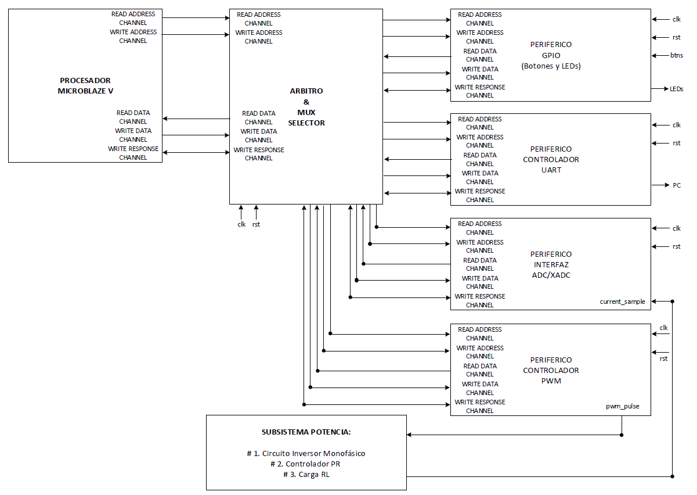

# Diseño de Control de corriente en un inversor monofásico mediante un regulador PR discreto sobre MicroBlaze V

## Primer Nivel: Descripción General del Sistema
El primer nivel muestra como el sistema pulsaciones de botones y devuelve al usuario las muestras de corriente guardadas por el sistema y el estado en que se encuentra este por medio de indicadores LED.

---

## Segundo Nivel: Arquitectura de Subsistemas
El segundo nivel, expande el sistema completo en 2 subsistemas. El primero, el Subsistema Digital, se encarga de manejar las pulsaciones de los botones, guardar las muestras de corriente provenientes del segundo subsistema, mostrar el estado del sistema por medio de LEDs, y de enviar las muestras a un computador para su posterior visualización. El segundo subsistema, el Subsistema de Potencia, es el encargado de proporcionar las muestras de corriente al subsistema Digital, este se sincroniza con el primer subsistema por medio de una señal producida por el PWM dentro de este último.

---

## Tercer Nivel: 
El tercer nivel detalla el subsitema Digital, este desglosa como el subsistema es controlado por un procesador MicroBlaze V conectado a los periféricos por medio de un módulo "Árbitro & MUX" que decide que periférico recibe las señales de lectura o escritura. El sistema cuenta con una señal de reloj y reinicio general, "clk" y "rst" respectivamente. Tanto el procesador como los periféricos usan el protocolo AXI4(Lite) parra las señales.

---

## Cuarto Nivel: